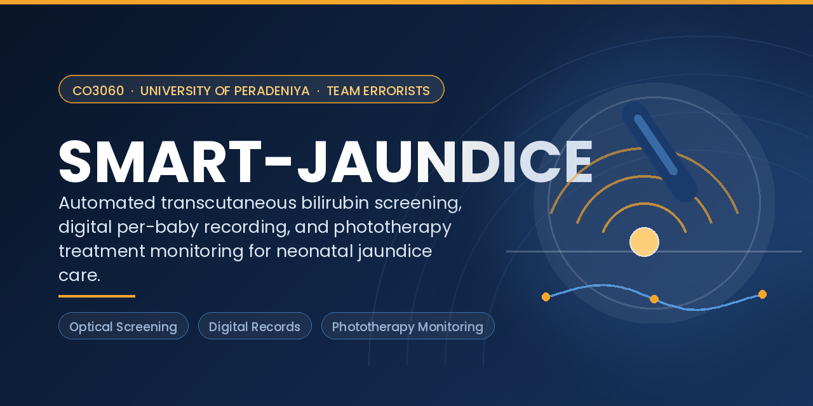
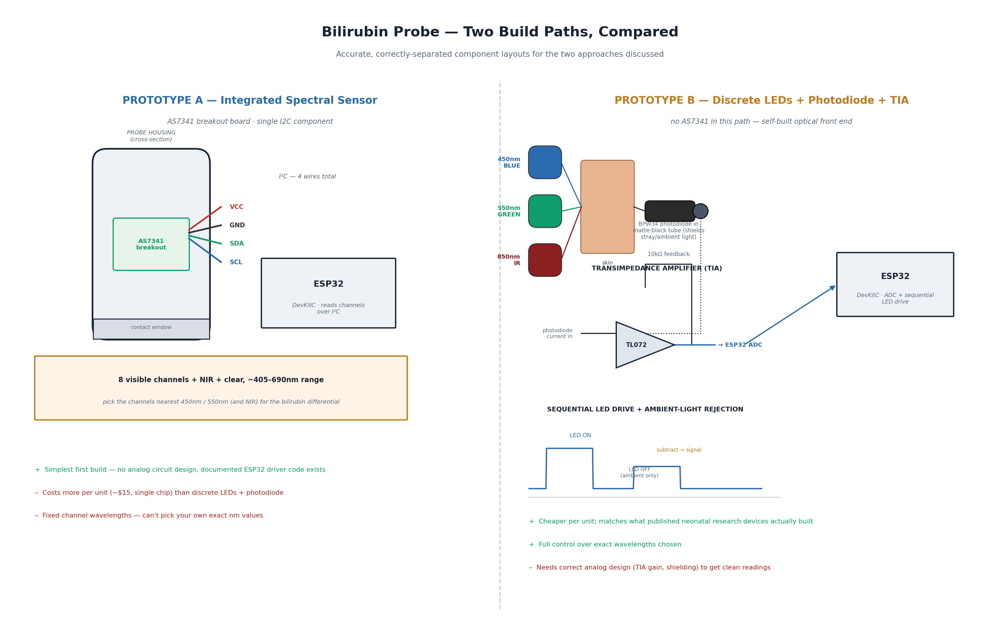
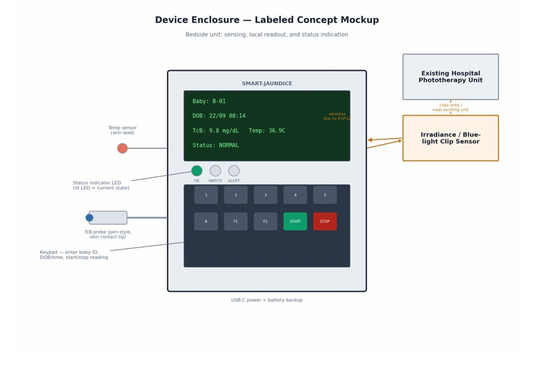

# SMART-JAUNDICE: Automated Transcutaneous Bilirubin Screening & Digital Recording System

**Group:** Errorists &nbsp;|&nbsp; **Department:** Computer Engineering, University of Peradeniya &nbsp;|&nbsp; **Course:** 3rd-Year Project (3YP) — CO3060

---

<p align="center">
  
</p>

## Overview

**SMART-JAUNDICE** is a low-cost, locally-buildable system for neonatal jaundice screening and monitoring. It pairs a multi-wavelength optical probe with an ESP32-based reader to estimate transcutaneous bilirubin and classify risk against the AAP's 2022 gestational-age-stratified thresholds, replaces handwritten paper charting with a digital per-baby record (ward dashboard + mobile app), and adds a treatment-monitoring module that continuously logs skin temperature and phototherapy lamp irradiance while a baby is under treatment.

The project does not aim to out-engineer existing clinical bilirubinometers on sensing accuracy alone. It targets the two failure points that sit upstream of — and within — treatment in resource-limited wards: unreliable naked-eye jaundice assessment, and error-prone manual record-keeping.

## Problem Statement

Neonatal jaundice affects roughly 60% of newborns in the first week of life. Most cases resolve on their own, but unrecognized, severe hyperbilirubinemia can progress to kernicterus — permanent neurological damage. Three gaps drive this risk, more than any shortage of treatment itself:

- **Detection gap** — naked-eye jaundice assessment is the first-line screening step almost everywhere, but it is documented as unreliable: physicians correctly identify only ~50–51% of infants with clinically significant hyperbilirubinemia by eye, and inter-observer agreement is only "fair" (κ = 0.29). Dedicated transcutaneous bilirubinometers exist but are too costly for routine use in most local wards.
- **Recording gap** — bilirubin trends are tracked by hand on paper charts. A 2024 systematic review of medical documentation quality found inaccuracy in 29% of studies and incompleteness in 98%, with manual transcription identified as a primary driver.
- **Treatment-monitoring gap** — once phototherapy begins, lamp irradiance and skin temperature are assumed to stay in range but often are not checked reliably: one evaluation found half of in-use phototherapy units failed to sustain intensive-level irradiance by their third follow-up check, and an unmonitored infant's hyperthermia rate (31.8%) fell to 4.5% with active thermal shielding.

## Aim and Objectives

**Aim:** to close the detection, recording, and treatment-monitoring gaps in neonatal jaundice care with a single low-cost, locally-buildable device and digital record system.

1. **Predictive risk flagging** — automate hour-specific, gestational-age-stratified risk classification (AAP/Bhutani framework) from a single bedside reading, instead of manual chart cross-referencing.
2. **Locally-calibrated refinement layer** — train an offline regression model on phantom, cross-device, and (where available) clinical calibration data, to refine — never replace — the clinically validated AAP thresholds for local accuracy.
3. **Treatment-phase verification** — continuously monitor skin temperature and phototherapy lamp irradiance to catch silent treatment failures that scheduled, hour-meter-based manual checks are documented to miss.

## System Architecture

```
 [Sensors]            [ESP32]                      [Cloud Backend]            [Client Apps]
 TcB probe       ┐                                                        ┌──  Ward Dashboard
 Temp sensor     ├──▶  Sensor Fusion +  ───▶   REST API + Database  ───▶  ┤
 Irradiance clip ┘     Threshold Engine                                   └──  Mobile App
                              │
                              ▼
                     Local LCD + Keypad
                     (per-baby profile)
```

### Sensing & Monitoring Modules

| Module | Sensor | Application |
|---|---|---|
| Bilirubin probe — Prototype A | AS7341 11-channel spectral sensor (I2C) | Multi-wavelength differential optical density screening |
| Bilirubin probe — Prototype B | Discrete 450/550/850 nm LEDs + BPW34 photodiode + transimpedance amplifier | Same measurement, cheaper and fully custom analog front end |
| Skin temperature | DS18B20 (1-Wire) | Continuous skin-temperature monitoring during phototherapy |
| Lamp irradiance | BPW34 photodiode + blue-pass filter | Continuous phototherapy lamp output verification |
| Bedside interface | 16×2 I2C LCD + 4×4 membrane keypad | Per-baby profile entry and at-a-glance status |

### Calibration & Risk-Classification Engine

Raw sensor signal is converted to a TSB-equivalent mg/dL value through a three-stage calibration process, then interpreted against the existing, clinically validated AAP 2022 thresholds — never a newly invented percentile chart:

1. **Phantom/bench calibration** — regression against bilirubin standards of known concentration.
2. **Cross-device calibration** — Bland–Altman agreement against a reference TcB instrument.
3. **Clinical validation (future work)** — paired heel-stick TSB blood draws; requires ethics approval and a hospital partner, out of scope for this project's timeline.

The locally-calibrated model is trained **offline, once**, on collected calibration data — it is explicitly not a continuously self-updating model, and it only ever refines, never replaces, the AAP safety thresholds. The application layer is decision-support only: it surfaces the measured value and its AAP-threshold status (Normal / Watch / Alert), never a medication or dosage instruction.

## Prototype Build Options

Two sensing front-ends are being evaluated in parallel for the optical probe:

<p align="center">
  
</p>

| | Prototype A — AS7341 | Prototype B — Discrete LED + Photodiode |
|---|---|---|
| Build complexity | Low — single I2C breakout, documented driver code | Higher — requires correct transimpedance-amplifier analog design |
| Wavelength control | Fixed channels (8 visible + NIR + clear) | Full control (450 / 550 / 850 nm chosen directly) |
| Approx. unit cost | ~LKR 9,500 (imported, landed cost) | ~LKR 1,500 in optical/amp components |
| Best for | Fastest correct first build | Lowest cost once the analog front end is validated |

<p align="center">
  
</p>

## Development Timeline (~20 Weeks)

> Indicative phase breakdown for the course semester — refined against the official CO3060 schedule as it is issued.

| Phase | Weeks | Activities |
|---|---|---|
| 1. Requirements & Literature Review | 1–3 | Problem/gap analysis, literature review, sensing-principle validation, proposal |
| 2. System & Circuit Design | 4–6 | Architecture design, Prototype A/B schematics, component sourcing, budget |
| 3. Probe Build & Bench Calibration | 7–10 | Hardware assembly, firmware bring-up, phantom/bench calibration regression |
| 4. Treatment-Monitoring Module | 9–11 | Temperature + irradiance sensing, integration with existing phototherapy unit |
| 5. Cross-Device Calibration & Firmware Integration | 12–14 | Bland–Altman comparison, AAP threshold engine, sensor fusion on ESP32 |
| 6. Backend & Client Apps | 13–17 | REST API, database, ward dashboard, mobile app, per-baby profiles |
| 7. Integration Testing, Documentation & Demo | 18–20 | End-to-end testing, enclosure finishing, final report, competition/demo prep |

## Evaluation Methodology

- **Sensing accuracy** — regression fit (R², RMSE) against known bilirubin-standard phantoms; Bland–Altman bias and limits of agreement against a reference TcB meter.
- **Threshold-engine correctness** — unit tests cross-checking the AAP 2022 gestational-age-stratified tables (6 curves × risk-factor status × 24 h × 14 days).
- **Treatment-monitoring accuracy** — temperature and irradiance sensor readings validated against a reference thermometer and light meter.
- **System response time** — latency from a bedside reading to dashboard/app update.
- **Usability** — informal review of the bedside unit and dashboard with clinical/nursing staff.

This is a device- and software-evaluation methodology, not a clinical-outcome study — paired-TSB clinical validation is explicitly future work (see Scope).

## Safety

- The device is battery-powered and low-voltage throughout — no mains-voltage circuitry.
- It is a **screening and monitoring aid only**: it displays the measured value and AAP-threshold status, never a medication or dosage instruction. All treatment decisions remain with clinical staff.
- It is **not validated for use on real neonates** within this project's timeline. Clinical use requires ethics approval and a hospital partnership (see Scope).
- Bilirubin calibration standards and any lab reagents are handled per the supervising department's / partner lab's safety protocol.

## Scope

| Included | Not Included |
|---|---|
| Low-cost multi-wavelength optical bilirubin screening probe (two candidate designs) | Replacement for TSB (blood draw) as the diagnostic gold standard |
| AAP 2022 gestational-age-stratified threshold classification | Clinical validation on real neonates within this project's timeline |
| Locally-calibrated, offline-trained refinement layer | Continuously self-updating / online-learning model in deployment |
| Digital per-baby record — ward dashboard + mobile app | Anemia/hemoglobin detection (reserved as future work) |
| Continuous phototherapy treatment monitoring (temperature + irradiance) | GPS-based automatic population recalibration |
| Three-stage calibration: phantom → cross-device → (pathway for) clinical validation | Autonomous treatment or dosage decisions |

## Budget

Sourced from Sri Lankan electronics retailers (roboclub.lk, alphatronic.lk, tronic.lk, duino.lk, nilambaraelectronics.com), October 2026 pricing.

| Prototype | Scope | Approx. Cost (LKR) |
|---|---|---|
| Prototype A | Optical screening reader (AS7341-based) | ≈ 13,900 |
| Prototype B | Phototherapy treatment-monitoring unit | ≈ 3,500 |
| **Total — both working units** | | **≈ 17,400 (≈ USD 53)** |

The imported AS7341 sensor is the main source of uncertainty (realistic range LKR 8,000–12,000 depending on shipping/customs); every other component is stocked locally.

## Deliverables

- Two bench-calibrated bilirubin-sensing prototypes (A: AS7341-based, B: discrete LED + photodiode) with documented accuracy against known bilirubin standards.
- A working ward dashboard and mobile app with per-baby profiles, trend charts, and automatic AAP-threshold alerts — replacing paper charting end-to-end.
- A treatment-monitoring module (temperature + lamp-irradiance logging) demonstrated on an existing hospital phototherapy unit.
- A documented three-stage calibration methodology (bench → cross-device → future clinical) that a later cohort can extend directly into clinical validation.

## Technology Stack

| Area | Tools |
|---|---|
| Firmware | ESP32 (Arduino framework), I2C sensor drivers (AS7341), analog front end (BPW34 photodiode + transimpedance amplifier), DS18B20 1-Wire temperature sensing |
| Connectivity | Wi-Fi / BLE, JSON over HTTPS (periodic sync) |
| Backend | REST API, patient/reading database, authentication *(implementation framework to be finalized)* |
| Client Apps | Ward web dashboard, mobile app — per-baby profiles, trend charts, AAP-threshold alerts *(implementation framework to be finalized)* |
| Calibration & Modeling | Offline regression/classification modeling for the locally-calibrated refinement layer |
| Hardware Design | Circuit schematics for the discrete-component front end (Prototype B) |
| Documentation | LaTeX project proposal and budget reports |

## Team

| Name | E-Number | Role | Email |
|---|---|---|---|
| P. Manojh | E/22/227 | Team Lead | e22227@eng.pdn.ac.lk |
| K. Bhaveenthan | E/22/051 | Member | e22051@eng.pdn.ac.lk |
| A.L. Jeyanth | E/22/176 | Member | e22176@eng.pdn.ac.lk |
| P. Pathimilan | E/22/271 | Member | e22271@eng.pdn.ac.lk |

*(University email addresses follow the department's standard E-number pattern — double-check before publishing.)*

## Supervisor

*To be announced.*

## Links

- Project page: `<!-- e.g. https://cepdnaclk.github.io/<repo-name> -->`
- Department of Computer Engineering: [https://ce.pdn.ac.lk/](https://ce.pdn.ac.lk/)

## Project Status

📋 Proposal and system design — **complete**. Circuit schematics, enclosure concept, and component budget finalized. Prototype build, firmware, calibration, and dashboard/app development — **in progress**.

---

*This README follows the CO3060 3YP project-page template.*
